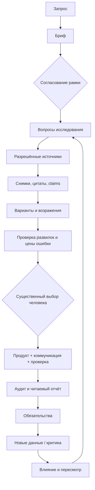

# Архитектура v0.3

Модель работает в IDE, читает AGENTS.md, выбирает следующий шаг и инструменты. Python - детерминированный слой атрибуции, вычислений и состояния. Он не генерирует стратегию за модель и не является автономной платформой.

## Слои и контекст

| Слой | Файлы | Смысл |
| --- | --- | --- |
| Правила | AGENTS.md и .cursor/rules | Полномочия, переходы, работа с источниками |
| Методика | knowledge/ | Исследование, стратегия, эксплуатация |
| Навыки | .agents/skills/ | Критика, пересмотр и decision-lab |
| Материалы | project/blobs/ | Неизменяемые снимки, контрольные суммы, локаторы |
| Состояние | project/state.json | Claims, текущие документы, подтверждения, обязательства, расходы и события |
| Выдача | project/exports/ | HTML и Markdown, аудит и граф; каждый файл - снимок ревизии |

В новый чат передаётся resume и context с явным лимитом символов и пропусками. Нужные источники находятся через BM25 и двуязычный словарь понятий, затем читаются по локатору. Есть явные связи source→derived→claim→decision; impact показывает влияние до отзыва. Это не векторный индекс и не автоматическая проверка смысловой истинности.

## Компоненты и оправдание сложности

| Компонент | Назначение | Издержки и границы |
| --- | --- | --- |
| Python standard library | CLI, хранение и вычисления | Нет обязательных внешних библиотек или ключей для агента/replay |
| HTMLParser/urllib, CSV, DOCX/XLSX XML | Документы, таблицы и публичные сайты | Office-функции не исполняются; формулы XLSX отклоняются; PDF/OCR не заявлены |
| JSON, lock, os.replace | Продолжение и атомарная запись | Один писатель, локальная ФС; зависший lock разрешается явно |
| SHA-256, цепочка событий | Сохранность и история | Не криптографическое удостоверение правды или личности |
| Билингвальный BM25 и context | Поиск и уменьшение начального контекста | Требует чтения пропущенных оснований по запросу; измерение в байтах, не токенах |
| MCP stdio | 7 инструментов только для чтения | Один проект, без shell и сетевого слушателя; проверен subprocess, не все IDE |
| Dashboard | Обзор решения и проверяемые основания | Статический локальный снимок с фильтрами, не редактор и не фоновой монитор |
| Проверка пилота | Фиксация порога, выборки и знаменателя до импорта, разбор неизвестных исходов и условий расширения | Два плеча, один бинарный исход, фиксированные сроки. Итог — указание для следующего решения владельца. |
| Три skills | Критика, сценарная проверка и пересмотр | Модель выполняет критический проход. Результаты отдельного сравнения ограничены объёмом замеров. |

Изменения брифа, исследования и вариантов снимают зависимые согласования. Новые источники требуют проверки релевантности. При отзыве прослеживаются производные источники и claims; прежнее решение перестаёт считаться подтверждённым. Старые обязательства явно переносятся на новый выбор с причиной и записью прежнего хеша.

## Модели и сервисы

Реальный кейс создан текущей LLM-сессией Codex с чтением файлов, Python CLI и веб-поиском/открытием первичных страниц. Точный серверный идентификатор модели, usage и тариф инструментами среды не получены. Другие платные модельные API не подключались. Advisory routing выбирает процедуру, а не переключает модели. MCP не вызывает LLM самостоятельно.

Для браузерной проверки и PDF при сборке использованы Playwright с Edge, ReportLab, Poppler, Pillow и pypdf из bundled runtime. Это инструменты упаковки и проверки автора, не зависимости обычного агента и offline-demo.

## Устойчивость и безопасность

Сайт, вернувший Client Challenge, не считается прочитанным. В реальном кейсе прямое чтение было заблокировано; источник открыт веб-инструментом, краткие выдержки импортированы с URL и записью метода. Ограничения доступа не обходились. Полные чужие статьи не перепубликуются.

Проверяются относительные пути: изменение state не должно позволять прочитать файл вне проекта. Экспорт HTML экранирует тексты и не загружает внешние скрипты. Источники не дают новых полномочий. Состояние и собственные отчёты нельзя импортировать как независимое доказательство. Секреты и персональные данные запрещено помещать в материалы; полноценного DLP и сетевой песочницы нет.

Частичное падение до commit сохраняет прежний state; возможен неиспользуемый blob. Повторный импорт идентичных данных идемпотентен, сетевой снимок с существующим ID незаметно не заменяется. Audit проверяет структуру и атрибуцию; экспертное качество и истинность выводов требуют отдельной оценки.
